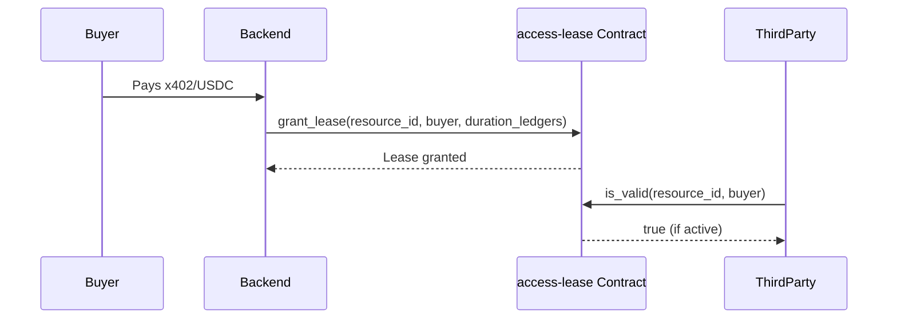
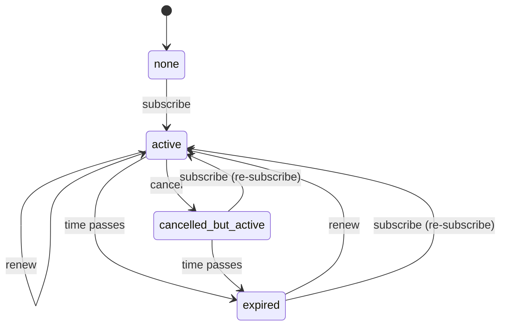

# SynapsVault Contracts — Interface Reference

This document is the source-of-truth reference for the public interface,
storage layout, events and error codes of each contract in this workspace.
Keep it in sync with the code: any change to a contract's public interface,
storage or error codes must update this file in the same pull request.

- [Common conventions](#common-conventions)
  - [Upgrades and migration](#upgrades-and-migration)
- [vault-registry](#vault-registry)
- [access-lease](#access-lease)
- [subscription](#subscription)

---

## Common conventions

| Topic | Convention |
|---|---|
| Amounts | `i128` USDC stroops (7 decimals). Always strictly positive. |
| Time | Ledger sequence numbers (`u32`). ~5 s per ledger, 17,280 ledgers ≈ 1 day. |
| Admin | A single admin address held in instance storage, set once by `init`. In production this is the backend platform wallet. |
| `init` | One-time. A second call fails with `AlreadyInitialised` — it can never overwrite the admin. `init` does not require the admin's signature, so deploy and init in the same pipeline run. |
| Admin rotation | `set_admin(new_admin)` on `access-lease` and `subscription`, gated by the current admin. |
| Upgrades | `upgrade(new_wasm_hash)` — admin-only; storage is preserved. |
| Versioning | `get_version()` returns the version recorded at `init` (crate version); `is_compatible(...)` detects stale deployments. |
| Errors | Every fallible entrypoint returns `Result<_, Error>`; codes are stable and never renumbered. |
| Events | Defined as `#[contractevent]` types (so they appear in the contract spec and generated bindings). Topics start with a fixed symbol; data is a single value. Unit tests (`events_have_documented_shape`) pin the wire format. |
| Cross-contract calls | Contracts in this workspace are **independent**: none of them performs a cross-contract call to another SynapsVault contract. Each contract validates only its own inputs and trusts the admin/backend to supply consistent identifiers. See [Cross-contract trust model](#cross-contract-trust-model). |

### Roles

| Role | Capabilities |
|---|---|
| **Admin** | Initialise-time owner. Upgrades contracts, rotates itself, grants/extends/revokes leases, subscribes/renews subscribers. |
| **Creator** (`vault-registry`) | Registers resources and is the only one able to mutate them; may transfer ownership. |
| **Publisher** (`subscription`) | Creates and deactivates their own plans. |
| **Buyer / Subscriber** | Holds leases/subscriptions; a subscriber can cancel their own subscription. |
| **Anyone** | All read-only entrypoints (`get`, `list`, `is_valid`, `is_active`, …) are permissionless. |

### Cross-contract trust model

SynapsVault contracts are deployed and operated as a set but are **not wired
together on-chain**. In particular, `access-lease` does **not** call
`vault-registry` to verify that a `resource_id` exists before granting a lease.

This is a deliberate decision, not an oversight:

- **Trusted admin.** `grant_lease` / `extend_lease` are admin-only. The admin is
  the backend platform wallet, which is the same actor that registers resources
  in `vault-registry`. It is expected to only grant leases for resources it has
  registered.
- **No coupling / no upgrade hazard.** A cross-contract call would hard-code the
  `vault-registry` contract id into `access-lease`, coupling their deployments
  and upgrade paths, and would add a re-entrancy / failure surface for a check
  that the trusted caller already guarantees.
- **Cheap off-chain verification.** Any party can independently confirm a
  resource exists via the permissionless `vault-registry::exists(id)` read, so
  the invariant is verifiable without an on-chain check.

Consequence: a lease may reference a `resource_id` that is not (or no longer)
registered. Consumers should treat `access-lease` as the authority on *lease*
existence and `vault-registry` as the authority on *resource* existence, and
check both when both matter.

### Upgrades and migration

All three contracts expose the same two admin-gated entrypoints for changing
code: `upgrade(new_wasm_hash)` and `migrate()`. Both require the stored admin's
signature and fail with `NotInitialised` before `init`.

**What `upgrade` does**

- Replaces the contract's WASM with `new_wasm_hash` (which must already be
  uploaded) via `update_current_contract`. The new code runs from the next
  invocation onwards; the rest of the `upgrade` call still runs the old code.
- Emits `("upgrade",)` with the new WASM hash.

**What `upgrade` preserves**

- The contract ID, so clients and the backend keep using the same address.
- All storage — instance, persistent and temporary — exactly as it was. That
  includes the admin, every resource, lease, plan and subscription, and the
  stored version string.
- Entry TTLs. `upgrade` does not extend the TTL of persistent entries.

**What `upgrade` does *not* do**

- **It does not update the stored version.** `get_version()` keeps returning
  the version written at `init` (or by the last `migrate`) until `migrate` is
  called. On `vault-registry`, `version()` already reports the new compiled
  version while `get_version()` still reports the old one.
- **It does not migrate data.** Stored values are decoded with the new code's
  types. A layout change to a stored type (for example adding, removing or
  reordering fields of `Resource`, `Lease`, `Plan` or `Subscription`, or
  changing a `DataKey` variant) makes existing entries unreadable, and calls
  that read them will trap. There is no automatic conversion.
- It does not re-run `init`, change the admin, or reset error codes.

**What `migrate` does**

- Writes the running WASM's compile-time version into the stored `Version`
  slot, so `get_version()` (and `is_compatible()`) reflect the new code, and
  extends the instance TTL.
- It is idempotent: calling it again just re-writes the same version.
- It does not transform any stored data. `access-lease` emits
  `("migrate",)` with the new version; `vault-registry` and `subscription`
  emit no event.

**Upgrade procedure**

1. Upload the new WASM and get its hash (see README → Upgrades).
2. Call `upgrade(new_wasm_hash)` as the admin.
3. Call `migrate()` as the admin, in a separate transaction, so the stored
   version matches the running code.
4. Check `get_version()` and read a few existing entries to confirm they still
   decode.

**Changing a stored type safely**

Because nothing is migrated automatically, a release that changes a stored
type must either keep the old encoding readable (for example by storing the
new shape under a new `DataKey` and falling back to the old key on read), or
ship explicit migration logic in the new WASM that rewrites old entries.
Test the upgrade against existing data on testnet before mainnet.

**Rolling back** is another `upgrade` to the previous WASM hash, followed by
`migrate`. It is only safe if the newer code has not written entries in a
layout the older code cannot decode.

---

## vault-registry

On-chain registry of vault resources: creator, price, metadata pointer, tags
and listing status. Payment itself happens off-contract (x402 + USDC SAC); the
registry is the transparent source of truth for *what* exists, *who* owns it
and *what* it costs.

### Data

```rust
pub struct Resource {
    pub id: String,         // unique, immutable
    pub creator: Address,   // only address allowed to mutate the resource
    pub price: i128,        // USDC stroops, > 0
    pub metadata: String,   // IPFS URI / content hash, <= 512 bytes
    pub listed: bool,       // true on register
    pub tags: Vec<String>,  // <= 8 tags, each 1..=32 bytes
}
```

| Constant | Value |
|---|---|
| `MAX_RESOURCE_ID_LEN` | 64 bytes |
| `MAX_METADATA_POINTER_LEN` | 512 bytes |
| `MAX_TAGS` | 8 |
| `MAX_TAG_LEN` | 32 bytes |
| `MAX_PAGE_SIZE` | 20 |

### Functions

| Function | Auth | Returns | Errors |
|---|---|---|---|
| `init(admin)` | — (one-time) | `()` | `AlreadyInitialised` |
| `admin()` | — | `Address` | `NotInitialised` |
| `upgrade(new_wasm_hash)` | Admin | `()` | `NotInitialised` |
| `migrate()` | Admin | `()` — refreshes the stored version after `upgrade` | `NotInitialised` |
| `register(creator, id, price, metadata, tags)` | `creator` | `()` | `InvalidResourceId`, `InvalidPrice`, `MetadataTooLong`, `MetadataEmpty`, `InvalidTag`, `AlreadyRegistered` |
| `set_price(id, new_price)` | Creator | `()` | `InvalidResourceId`, `NotFound`, `InvalidPrice` |
| `update_metadata(id, metadata)` | Creator | `()` | `InvalidResourceId`, `NotFound`, `MetadataEmpty`, `MetadataTooLong` |
| `set_tags(id, tags)` | Creator | `()` | `InvalidResourceId`, `NotFound`, `InvalidTag` |
| `propose_transfer(id, new_creator)` | Creator | `()` | `InvalidResourceId`, `NotFound` |
| `accept_transfer(id, new_creator)` | `new_creator` | `()` | `InvalidResourceId`, `NotFound`, `NoPendingTransfer`, `NotPendingOwner` |
| `cancel_transfer(id)` | Creator | `()` | `InvalidResourceId`, `NotFound` |
| `set_listed(id, listed)` | Creator | `()` | `InvalidResourceId`, `NotFound` |
| `delist(id)` | Creator | `()` | `InvalidResourceId`, `NotFound` |
| `list(start, limit, only_listed, tag)` | — | `Vec<Resource>` | — (limit capped at 20; scan window capped at `limit*2 + 20` slots) |
| `list(start, limit)` | — | `Vec<Resource>` | — (limit capped at 20) |
| `get(id)` | — | `Resource` | `NotFound` |
| `exists(id)` | — | `bool` | — |
| `get_owner(id)` | — | `Address` | `NotFound` |
| `count()` | — | `u32` | — |
| `version()` | — | `String` (compiled version) | — |
| `get_version()` | — | `String` (version stored at `init`) | — |
| `is_compatible(version)` | — | `bool` — major.minor matches | — |

The registry itself works without `init`; the admin is only needed for `upgrade` and `migrate`. See [Upgrades and migration](#upgrades-and-migration).

### Ownership transfer (two-step)

Ownership transfer is a two-step flow to prevent permanently locking a resource
with a mistyped address (fixes #77):

- `propose_transfer(id, new_creator)` — current creator proposes a new owner.
  Stores a `PendingOwner` entry. No-op if `new_creator` is already the current
  creator (fixes #78).
- `accept_transfer(id, new_creator)` — proposed new owner accepts, takes
  ownership, and the pending entry is removed.
- `cancel_transfer(id)` — current creator cancels, removes the pending entry.
  No-op if no proposal is pending.

### `list` filtering and gas bounds

`list(start, limit, only_listed, tag)` accepts two optional filters (fixes #70, #71):

- `only_listed: bool` — when `true`, resources with `listed = false` (delisted
  or retired) are excluded. Pass `false` to include all resources.
- `tag: Option<String>` — when `Some(t)`, only resources whose tag list contains
  `t` are included. Tags are stored lower-cased, so pass a lower-cased value.
  Pass `None` to disable tag filtering.

The scan window is capped at `limit * 2 + MAX_PAGE_SIZE` index slots (fixes #69).
This keeps every call O(constant) in gas regardless of registry size: at most
`20 * 2 + 20 = 60` index reads per call. If the registry is sparse in the
requested range, advance `start` and paginate to retrieve more results.

### Storage

| Key | Storage | Value | TTL |
|---|---|---|---|
| `Resource(id)` | persistent | `Resource` | bumped to 30 days on every write |
| `Index(i)` | persistent | resource id (insertion order) | bumped to 30 days on write |
| `PendingOwner(id)` | persistent | `Address` (proposed new owner) | bumped to 30 days on write |
| `Count` | instance | `u32`, monotonic | instance bumped on write |
| `Admin` | instance | `Address` | — |
| `Version` | instance | `String` | — |

### Events

| Topics | Data |
|---|---|
| `("init",)` | admin |
| `("register", creator)` | id |
| `("setprice", id)` | new price |
| `("updmeta", id)` | new metadata pointer |
| `("settags", id)` | tags |
| `("proptrans", id)` | proposed new creator |
| `("transfer", id)` | new creator (on `accept_transfer`) |
| `("canceltrans", id)` | `()` |
| `("setlisted", id)` | listed |
| `("upgrade",)` | new wasm hash |

### Errors

| Code | Name | Meaning |
|---|---|---|
| 1 | `AlreadyRegistered` | `id` already exists. |
| 2 | `NotFound` | No resource with `id`. |
| 3 | `InvalidPrice` | Price ≤ 0. |
| 4 | `MetadataTooLong` | Metadata > 512 bytes. |
| 5 | `InvalidTag` | > 8 tags, or a tag is empty / > 32 bytes / duplicate. |
| 6 | `NotAdmin` | Reserved. |
| 7 | `NotInitialised` | Admin-only call before `init`. |
| 8 | `AlreadyInitialised` | `init` called twice. |
| 9 | `MetadataEmpty` | Metadata pointer is an empty string. |
| 10 | `InvalidResourceId` | Resource id is empty or > 64 bytes. |
| 11 | `NoPendingTransfer` | `accept_transfer` called with no pending proposal. |
| 12 | `NotPendingOwner` | Caller is not the proposed new owner. |

---

## access-lease

Time-limited access grants. The backend issues a `Lease` with an `expires_at`
ledger; any party can verify access with a single permissionless read.

### Lifecycle Diagram



### Data

```rust
pub struct Lease {
    pub resource_id: String,
    pub buyer: Address,
    pub granted_at: u32,       // ledger of grant
    pub expires_at: u32,       // exclusive
    pub duration_ledgers: u32, // as originally requested
}
```

A lease is valid iff it exists and `expires_at > ledger.sequence()`.

### Functions

| Function | Auth | Returns | Errors |
|---|---|---|---|
| `init(admin)` | — (one-time) | `()` | `AlreadyInitialised` |
| `admin()` | — | `Address` | `NotInitialised` |
| `set_admin(new_admin)` | Admin | `()` | `NotInitialised` |
| `grant_lease(resource_id, buyer, duration_ledgers)` | Admin | `Lease` | `NotInitialised`, `InvalidDuration`, `AlreadyActive`, `InvalidResourceId` |
| `grant_leases(requests)` | Admin | `Vec<Lease>` | `NotInitialised`, `InvalidDuration`, `AlreadyActive`, `InvalidResourceId` |
| `extend_lease(resource_id, buyer, extra_ledgers)` | Admin | `Lease` | `NotInitialised`, `InvalidDuration`, `LeaseNotFound` |
| `revoke_lease(resource_id, buyer)` | Admin | `()` | `NotInitialised`, `LeaseNotFound` |
| `is_valid(resource_id, buyer)` | — | `bool` | — |
| `get_lease(resource_id, buyer)` | — | `Lease` (even if expired; `LeaseNotFound` if revoked) | `LeaseNotFound` |
| `get_version()` | — | `String` | — |
| `is_compatible()` | — | `bool` — stored version == compiled | — |
| `upgrade(new_wasm_hash)` | Admin | `()` | `NotInitialised` |
| `migrate()` | Admin | `()` — refreshes the stored version after `upgrade` | `NotInitialised` |

### Semantics

- `grant_lease` rejects a zero duration and any duration whose expiry would
  overflow `u32`. An expired lease may be replaced by a new grant.
- `grant_lease` does **not** verify that `resource_id` exists in
  `vault-registry`; see [Cross-contract trust model](#cross-contract-trust-model).
- `extend_lease` computes `max(expires_at, now) + extra_ledgers`, so an expired
  lease restarts from the current ledger. Zero / overflowing extensions are rejected.
- `revoke_lease` deletes the record.

### Storage

| Key | Storage | Value | TTL |
|---|---|---|---|
| `Admin` | instance | `Address` | instance bumped to 90 days on admin calls |
| `Version` | instance | `String` | — |
| `Lease(resource_id, buyer)` | persistent | `Lease` | bumped to 90 days on write |

### Events

| Topics | Data |
|---|---|
| `("init",)` | admin |
| `("setadmin",)` | new admin |
| `("grant", resource_id, buyer)` | `expires_at` |
| `("extend", resource_id, buyer)` | new `expires_at` |
| `("revoke", resource_id, buyer)` | `()` |
| `("upgrade",)` | new wasm hash |
| `("migrate",)` | new stored version |

### Errors

| Code | Name | Meaning |
|---|---|---|
| 1 | `NotAdmin` | Reserved. Never returned: admin-gated entrypoints call `admin.require_auth()`, so a failed authorisation traps (panics) instead of returning this code. |
| 2 | `LeaseNotFound` | No lease for the pair. |
| 3 | `AlreadyActive` | A non-expired lease already exists for the pair. |
| 4 | `InvalidDuration` | Duration is zero or the resulting expiry overflows `u32`. |
| 5 | `NotInitialised` | Admin-only call before `init`. |
| 6 | `AlreadyInitialised` | `init` called twice. |
| 8 | `LeaseExpired` | The lease has already expired; there is nothing to revoke. |
| 9 | `InvalidResourceId` | Resource id is empty or > 64 bytes. |

---

## subscription

Recurring access plans. A publisher creates a `Plan`; the admin subscribes a
buyer to it, and the buyer can cancel. Payment happens off-contract (x402 +
USDC SAC); the contract records the entitlement window.

### Lifecycle Diagram



### Data

```rust
pub struct Plan {
    pub id: String,          // unique, immutable
    pub publisher: Address,  // only address allowed to mutate the plan
    pub price: i128,         // USDC stroops, > 0
    pub period_ledgers: u32, // billing period, > 0
    pub active: bool,        // true on create
}

pub struct Subscription {
    pub plan_id: String,
    pub subscriber: Address,
    pub started_at: u32,     // ledger of first subscribe
    pub expires_at: u32,     // exclusive
    pub period_ledgers: u32, // period as of the last subscribe/renew
}
```

A subscription is active iff it exists and `expires_at > ledger.sequence()`.

### Functions

| Function | Auth | Returns | Errors |
|---|---|---|---|
| `init(admin)` | — (one-time) | `()` | `AlreadyInitialised` |
| `admin()` | — | `Address` | `NotInitialised` |
| `set_admin(new_admin)` | Admin | `()` | `NotInitialised`, `SameAdmin` |
| `create_plan(publisher, id, price, period_ledgers)` | `publisher` | `()` | `InvalidPrice`, `InvalidPeriod`, `AlreadyExists`, `InvalidPlanId` |
| `set_plan_price(id, new_price)` | Publisher | `()` | `InvalidPrice`, `NotFound` |
| `set_plan_active(id, active)` | Publisher | `()` | `NotFound` |
| `transfer_plan(id, new_publisher)` | Publisher | `()` | `NotFound` |
| `subscribe(plan_id, subscriber, payment_reference)` | Admin | `Subscription` | `NotInitialised`, `NotFound`, `PlanInactive`, `AlreadySubscribed` |
| `renew(plan_id, subscriber, payment_reference)` | Admin | `Subscription` | `NotInitialised`, `NotFound`, `PlanInactive`, `NotSubscribed` |
| `cancel(plan_id, subscriber)` | Subscriber | `()` | `NotSubscribed` |
| `is_active(plan_id, subscriber)` | — | `bool` | — |
| `get_subscription(plan_id, subscriber)` | — | `Subscription` (even if expired) | `NotSubscribed` |
| `get_plan(id)` | — | `Plan` | `NotFound` |
| `get_version()` | — | `String` | — |
| `is_compatible()` | — | `bool` — stored version == compiled | — |
| `upgrade(new_wasm_hash)` | Admin | `()` | `NotInitialised` |
| `migrate()` | Admin | `()` — refreshes the stored version after `upgrade` | `NotInitialised` |

### Semantics

- `create_plan` rejects a zero price, zero period, and empty/>64 bytes plan ID.
- `subscribe` rejects a plan that is inactive and a subscriber that already has
  a subscription for the plan. The new window is `now + period_ledgers`.
  Requires a `payment_reference`.
- `renew` extends the subscription by `period_ledgers` from `max(expires_at, now)`.
  Requires a `payment_reference`.
  - While the subscription is still active (`expires_at > now`) the new expiry is
    `expires_at + period_ledgers`, so renewals stack without losing paid time.
  - After a lapse (`expires_at <= now`) the new expiry is `now + period_ledgers`,
    i.e. the window restarts from the current ledger.
  - **Gap is unbounded.** There is no cap on how long a subscription may sit
    expired before a renewal: a renewal after any gap (days, months, years)
    restarts a full `period_ledgers` window from `now`. This is intentional —
    the contract does not attempt to charge or back-fill for the lapsed period,
    and no retroactive access is granted. Callers that need to enforce a maximum
    grace window must do so off-contract before invoking `renew`.
  - Zero / overflowing extensions are rejected (`InvalidPeriod`).
- `cancel` deletes the record.

### Storage

| Key | Storage | Value | TTL |
|---|---|---|---|
| `Admin` | instance | `Address` | instance bumped to 90 days on admin calls |
| `Version` | instance | `String` | — |
| `Plan(id)` | persistent | `Plan` | bumped to 90 days on write |
| `Subscription(plan_id, subscriber)` | persistent | `Subscription` | bumped to 90 days on write |

### Events

| Topics | Data |
|---|---|
| `("init",)` | admin |
| `("setadmin",)` | new admin |
| `("createplan", id)` | publisher |
| `("setprice", id)` | new price |
| `("setactive", id)` | active |
| `("transfer", id)` | new publisher |
| `("subscribe", plan_id, subscriber)` | `(current_period_end, price, payment_reference)` |
| `("renew", plan_id, subscriber)` | `(current_period_end, price, payment_reference)` |
| `("cancel", plan_id, subscriber)` | `()` |
| `("upgrade",)` | new wasm hash |

### Errors

| Code | Name | Meaning |
|---|---|---|
| 2 | `NotFound` | No plan with `id`. |
| 3 | `AlreadyExists` | `id` already registered. |
| 4 | `InvalidPrice` | Price ≤ 0. |
| 5 | `InvalidPeriod` | Period is zero or the resulting expiry overflows `u32`. |
| 6 | `PlanInactive` | Plan is deactivated. |
| 7 | `AlreadySubscribed` | Subscriber already has a subscription for the plan. |
| 8 | `NotSubscribed` | No subscription for the pair. |
| 9 | `NotInitialised` | Admin-only call before `init`. |
| 10 | `AlreadyInitialised` | `init` called twice. |
| 12 | `InvalidPlanId` | `plan_id` is empty or > 64 bytes. |
| 13 | `SameAdmin` | The new admin address is the same as the current admin address. |