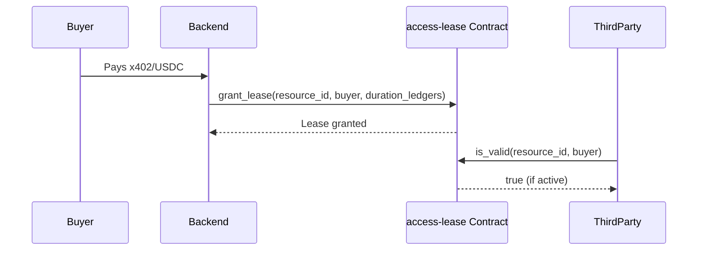
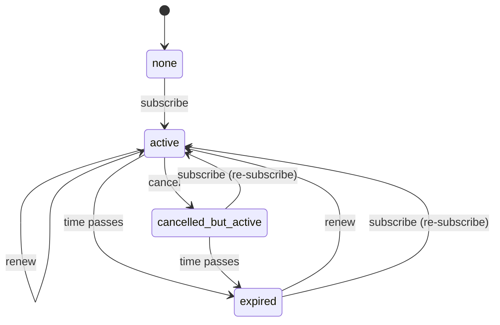

# SynapsVault Contracts — Interface Reference

This document is the source-of-truth reference for the public interface,
storage layout, events and error codes of each contract in this workspace.
Keep it in sync with the code: any change to a contract's public interface,
storage or error codes must update this file in the same pull request.

- [Common conventions](#common-conventions)
  - [Upgrades and migration](#upgrades-and-migration)
  - [Access-control matrix](#access-control-matrix)
- [vault-registry](#vault-registry)
- [access-lease](#access-lease)
- [subscription](#subscription)

---

## Common conventions

| Topic | Convention |
|---|---|
| Amounts | `i128` USDC stroops (7 decimals). Always strictly positive. |
| Time | Ledger sequence numbers (`u32`). ~5 s per ledger, 17,280 ledgers ≈ 1 day. |
| Expiry boundary | `expires_at` is **exclusive**: a lease or subscription is valid while `expires_at > ledger.sequence()`. On the ledger whose sequence equals `expires_at` the grant is already expired. This applies uniformly to `access-lease` and `subscription`. |
| Admin | A single admin address held in instance storage, set once by `init`. In production this is the backend platform wallet. |
| `init` | One-time. A second call fails with `AlreadyInitialised` — it can never overwrite the admin. `init` does not require the admin's signature, so deploy and init in the same pipeline run. |
| Admin rotation | `set_admin(new_admin)` on `access-lease` and `subscription`, gated by the current admin. |
| Upgrades | `upgrade(new_wasm_hash)` — admin-only; storage is preserved. |
| Versioning | `get_version()` returns the version recorded at `init` (crate version); `is_compatible` differs between contracts — see [Version compatibility checks](#version-compatibility-checks). |
| Errors | Every fallible entrypoint returns `Result<_, Error>`. Codes are **per-contract and stable**: each contract has its own independent enum, codes are never renumbered, and the same concept may have a different code in different contracts. Never hard-code a numeric code across contracts — see [Error code numbering](#error-code-numbering). |
| Events | Defined as `#[contractevent]` types (so they appear in the contract spec and generated bindings). Topics start with a fixed symbol; data is a single value. Unit tests (`events_have_documented_shape`) pin the wire format. |
| Cross-contract calls | Contracts in this workspace are **independent**: none of them performs a cross-contract call to another SynapsVault contract. Each contract validates only its own inputs and trusts the admin/backend to supply consistent identifiers. See [Cross-contract trust model](#cross-contract-trust-model). |

### Roles

| Role | Capabilities |
|---|---|
| **Admin** | Initialise-time owner. Upgrades contracts, rotates itself, grants/extends/revokes leases, subscribes/renews subscribers. |
| **Creator** (`vault-registry`) | Registers resources and is the only one able to mutate them; may transfer ownership. |
| **Publisher** (`subscription`) | Creates and deactivates their own plans. |
| **Buyer / Subscriber** | Holds leases/subscriptions; a subscriber can cancel their own subscription. |
| **Anyone** | All read-only entrypoints (`get`, `list`, `is_valid`, `is_active`, …) are permissionless. |

### Access-control matrix

Every mutating entrypoint and the signer it requires. The full matrix with
corresponding test names — including tests for rejection of unauthorised
callers — lives in [`SECURITY_AUDIT.md` § 2](../SECURITY_AUDIT.md#2-access-control-matrix-verified-by-tests).

| Entrypoint | Required signer |
|---|---|
| `vault-registry::register` | `creator` |
| `vault-registry::set_price` / `update_metadata` / `set_tags` | Stored creator |
| `vault-registry::set_listed` / `delist` | Stored creator |
| `vault-registry::propose_transfer` | Stored creator |
| `vault-registry::accept_transfer` | Proposed new creator |
| `vault-registry::cancel_transfer` | Stored creator |
| `vault-registry::upgrade` / `migrate` | Admin |
| `access-lease::grant_lease` / `extend_lease` / `revoke_lease` / `revoke_leases` | Admin |
| `access-lease::set_admin` / `propose_admin` / `accept_admin` / `cancel_admin_proposal` | Current admin (or pending admin for `accept_admin`) |
| `access-lease::upgrade` / `migrate` | Admin |
| `subscription::subscribe` / `renew` | Admin |
| `subscription::create_plan` / `deactivate_plan` / `transfer_plan` | Publisher |
| `subscription::cancel` | Subscriber |
| `subscription::set_admin` / `upgrade` / `migrate` | Admin |
| `*::init` | None — see [SV-12](../SECURITY_AUDIT.md#1-findings) |
| All `get*` / `is_valid` / `is_active` / `list` reads | None (permissionless) |
| `access-lease::lease_status` / `check_leases` / `extend_instance_ttl` | None (permissionless) |
| `subscription::sub_status` / `check_subscriptions` | None (permissionless) |

### Version compatibility checks

`is_compatible` has the same name in every contract but answers a **different
question** in `vault-registry` than in `access-lease` and `subscription`. Do not
call them interchangeably.

| | `vault-registry` | `access-lease`, `subscription` |
|---|---|---|
| Signature | `is_compatible(version: String) -> bool` | `is_compatible() -> bool` |
| Input | A version string **supplied by the caller** | None — reads the version **stored in the contract** |
| Compared against | The running WASM's compile-time version | The running WASM's compile-time version |
| Rule | `major.minor` prefixes are equal (patch is ignored) | Exact string equality (`major.minor.patch`) |
| Returns `false` when | The input is empty, longer than 32 bytes, not of the form `X.Y.Z` with numeric components (e.g. `"0.1"`, `"0.1."`, `"0.1.2.3"`), or has a different `major.minor` | No version is stored (never initialised), or the stored version differs in any component |
| Question it answers | "Is a client/tool built against `version` compatible with this registry?" | "Does this deployment's stored state match the code now running?" |

Examples, assuming the compiled version is `0.2.1`:

| Call | Result |
|---|---|
| `vault-registry::is_compatible("0.2.0")` | `true` — same `0.2` |
| `vault-registry::is_compatible("0.3.0")` | `false` |
| `access-lease::is_compatible()` with stored `0.2.0` | `false` — patch differs |
| `access-lease::is_compatible()` with stored `0.2.1` | `true` |

How to use them:

- **vault-registry** — call it off-chain with the version your client, SDK or
  indexer was built for (for example the version recorded in
  `deployed/contract-ids.env`). It does not look at storage, does not depend
  on `init`, and is unaffected by `upgrade`/`migrate`.
- **access-lease / subscription** — call it after a deployment or upgrade to
  detect a stale deployment. It returns `false` right after `upgrade` (the
  stored version is not updated by `upgrade`) until the admin runs `migrate`,
  and `false` on a contract that was never initialised.

Because the rules differ, a patch-only upgrade makes `access-lease` and
`subscription` report `false` until `migrate` runs, while `vault-registry`
keeps accepting clients on the same `major.minor`.

### Error code numbering

Each contract defines its **own** `Error` enum. The numbering is intentionally
per-contract rather than shared: a contract's codes are part of its public
interface and are stable (never renumbered), so aligning them across contracts
would require a breaking renumbering of at least one contract. Codes are
therefore only meaningful relative to a specific contract — clients, SDKs and
indexers must map a code to a name using the table for the contract they are
calling, never assume a shared numbering, and never hard-code a numeric code
across contracts.

The same concept can have a different code in each contract. Shared concepts:

| Concept | vault-registry | access-lease | subscription |
|---|---|---|---|
| `AlreadyInitialised` | 8 | 7 | 9 |
| `NotInitialised` | 7 | 5 | 8 |
| `NotAdmin` | 6 (reserved) | 1 (reserved) | — |
| `NotFound` | 2 | — (uses `LeaseNotFound`) | 2 (`PlanNotFound`) |
| `InvalidPrice` | 3 | — | 7 |
| `InvalidResourceId` / `InvalidPlanId` | 10 (`InvalidResourceId`) | 9 (`InvalidResourceId`) | 12 (`InvalidPlanId`) |

New codes added in this release:

| Concept | access-lease | subscription |
|---|---|---|
| `BatchTooLarge` | 12 | 14 |
| `NoPendingProposal` | 13 | — |
| `AdminProposalExpired` | 14 | — |
| `AlreadyAdmin` | 15 | — |
| `AlreadyPendingAdmin` | 16 | — |

Notes:

- `NotAdmin` is reserved in `vault-registry` and `access-lease` and never
  returned: admin-gated entrypoints call `admin.require_auth()`, so a failed
  authorisation traps instead of returning a code. `subscription` has no
  `NotAdmin` variant.
- Codes are not contiguous: gaps (for example `access-lease` has no 7,
  `subscription` has no 1 or 11) are intentional and must not be filled in,
  because doing so would renumber nothing but would still change the enum's
  discriminants if variants were reordered. Treat the numbers as fixed.
- The per-contract tables in each [Errors](#vault-registry-errors) section are
  authoritative; this table is a cross-reference only.

### Cross-contract trust model

SynapsVault contracts are deployed and operated as a set but are **not wired
together on-chain**. In particular, `access-lease` does **not** call
`vault-registry` to verify that a `resource_id` exists before granting a lease.

This is a deliberate decision, not an oversight:

- **Trusted admin.** `grant_lease` / `extend_lease` are admin-only. The admin is
  the backend platform wallet, which is the same actor that registers resources
  in `vault-registry`. It is expected to only grant leases for resources it has
  registered.
- **No coupling / no upgrade hazard.** A cross-contract call would hard-code the
  `vault-registry` contract id into `access-lease`, coupling their deployments
  and upgrade paths, and would add a re-entrancy / failure surface for a check
  that the trusted caller already guarantees.
- **Cheap off-chain verification.** Any party can independently confirm a
  resource exists via the permissionless `vault-registry::exists(id)` read, so
  the invariant is verifiable without an on-chain check.

Consequence: a lease may reference a `resource_id` that is not (or no longer)
registered. Consumers should treat `access-lease` as the authority on *lease*
existence and `vault-registry` as the authority on *resource* existence, and
check both when both matter.

### Upgrades and migration

All three contracts expose the same two admin-gated entrypoints for changing
code: `upgrade(new_wasm_hash)` and `migrate()`. Both require the stored admin's
signature and fail with `NotInitialised` before `init`.

**What `upgrade` does**

- Replaces the contract's WASM with `new_wasm_hash` (which must already be
  uploaded) via `update_current_contract`. The new code runs from the next
  invocation onwards; the rest of the `upgrade` call still runs the old code.
- Emits `("upgrade",)` with the new WASM hash.

**What `upgrade` preserves**

- The contract ID, so clients and the backend keep using the same address.
- All storage — instance, persistent and temporary — exactly as it was. That
  includes the admin, every resource, lease, plan and subscription, and the
  stored version string.
- Entry TTLs. `upgrade` does not extend the TTL of persistent entries.

**What `upgrade` does *not* do**

- **It does not update the stored version.** `get_version()` keeps returning
  the version written at `init` (or by the last `migrate`) until `migrate` is
  called. On `vault-registry`, `version()` already reports the new compiled
  version while `get_version()` still reports the old one.
- **It does not migrate data.** Stored values are decoded with the new code's
  types. A layout change to a stored type (for example adding, removing or
  reordering fields of `Resource`, `Lease`, `Plan` or `Subscription`, or
  changing a `DataKey` variant) makes existing entries unreadable, and calls
  that read them will trap. There is no automatic conversion.
- It does not re-run `init`, change the admin, or reset error codes.

**What `migrate` does**

- Writes the running WASM's compile-time version into the stored `Version`
  slot, so `get_version()` (and `is_compatible()`) reflect the new code, and
  extends the instance TTL.
- It is idempotent: calling it again just re-writes the same version.
- It does not transform any stored data. `access-lease` emits
  `("migrate",)` with the new version; `vault-registry` and `subscription`
  emit no event.

**Upgrade procedure**

1. Upload the new WASM and get its hash (see README → Upgrades).
2. Call `upgrade(new_wasm_hash)` as the admin.
3. Call `migrate()` as the admin, in a separate transaction, so the stored
   version matches the running code.
4. Check `get_version()` and read a few existing entries to confirm they still
   decode.

**Changing a stored type safely**

Because nothing is migrated automatically, a release that changes a stored
type must either keep the old encoding readable (for example by storing the
new shape under a new `DataKey` and falling back to the old key on read), or
ship explicit migration logic in the new WASM that rewrites old entries.
Test the upgrade against existing data on testnet before mainnet.

**Rolling back** is another `upgrade` to the previous WASM hash, followed by
`migrate`. It is only safe if the newer code has not written entries in a
layout the older code cannot decode.

---

## vault-registry

On-chain registry of vault resources: creator, price, metadata pointer, tags
and listing status. Payment itself happens off-contract (x402 + USDC SAC); the
registry is the transparent source of truth for *what* exists, *who* owns it
and *what* it costs.

### Data

```rust
pub struct Resource {
    pub id: String,         // unique, immutable
    pub creator: Address,   // only address allowed to mutate the resource
    pub price: i128,        // USDC stroops, > 0
    pub metadata: String,   // IPFS URI / content hash, <= 512 bytes
    pub listed: bool,       // true on register
    pub retired: bool,      // false on register; set true by retire_resource (irreversible)
    pub tags: Vec<String>,  // <= 8 tags, each 1..=32 printable-ASCII bytes (0x21–0x7E)
}
```

| Constant | Value |
|---|---|
| `MAX_RESOURCE_ID_LEN` | 64 bytes |
| `MAX_METADATA_POINTER_LEN` | 512 bytes |
| `MAX_TAGS` | 8 |
| `MAX_TAG_LEN` | 32 bytes |
| `MAX_PAGE_SIZE` | 20 |

**Tag character alphabet (fixes #195):** every byte of each tag must be a
printable non-space ASCII character in the range `0x21` (`!`) through `0x7E`
(`~`). Control bytes (0x00–0x1F) and whitespace (0x20, space) and DEL (0x7F)
are rejected. Non-ASCII bytes (≥ 0x80) are also rejected. Uppercase letters
are accepted on input and normalised to lowercase before storage, so the
effective stored alphabet is `[a-z0-9!"#$%&'()*+,\-./:;<=>?@[\\\]^_{|}~]`.
Any tag byte outside this range causes `InvalidTag`.

### Metadata pointer validation (fixes #203)

The `metadata` field on a `Resource` is an opaque byte string of 1–512 bytes.
The contract enforces only two on-chain rules:

1. **Non-empty** — an empty string is rejected with `MetadataEmpty`.
2. **Length ≤ 512 bytes** — a string longer than `MAX_METADATA_POINTER_LEN`
   is rejected with `MetadataTooLong`.

URI syntax, content-hash format, and reachability are **not** validated
on-chain. The backend is responsible for supplying well-formed pointers before
calling `register` or `update_metadata`.

**Supported pointer formats (examples):**

| Format | Example value |
|---|---|
| IPFS CIDv1 (base32) | `bafybeigdyrzt5sfp7udm7hu76uh7y26nf3efuylqabf3oclgtqy55fbzdi` |
| IPFS CIDv0 (base58) | `QmcDX14at6pX9BYRnB1rfm7oBRhGBPLqUoAyfeahXWFGeJ` |
| IPFS URI | `ipfs://bafybeigdyrzt5sfp7udm7hu76uh7y26nf3efuylqabf3oclgtqy55fbzdi` |
| IPFS gateway URL | `https://ipfs.io/ipfs/QmcDX14at6pX9BYRnB1rfm7oBRhGBPLqUoAyfeahXWFGeJ` |
| SHA-256 hex digest | `e3b0c44298fc1c149afbf4c8996fb92427ae41e4649b934ca495991b7852b855` |
| Compact JSON anchor | `{"cid":"bafybe…","sha256":"e3b0c4…"}` |

**What is validated off-chain (backend responsibility):**

- URI scheme and syntax (e.g. `ipfs://` or `https://`).
- Content-hash format and length (e.g. CIDv1 must be a valid multibase string).
- Reachability — the pointer must resolve before it is registered.
- Maximum length of 512 bytes is also a good client-side guard before submitting
  the transaction.

**Invalid frontend inputs that will be rejected on-chain:**

| Input | Error |
|---|---|
| `""` (empty string) | `MetadataEmpty` |
| A string of 513 or more bytes | `MetadataTooLong` |

**Invalid frontend inputs that pass on-chain but should be caught off-chain:**

| Input | Why it passes on-chain | Recommended off-chain check |
|---|---|---|
| `"not-a-uri"` | Arbitrary byte strings are accepted | Validate URI scheme |
| `"ipfs://BAFYBE…"` (uppercase CID) | Byte length is fine | Normalise to lowercase CID |
| `"https://example.com/"` (no content hash) | Byte length is fine | Require a content-addressable pointer |

### Identifier namespace and normalisation (fixes #204)

Resource IDs are opaque byte strings of 1–64 bytes. The contract enforces only
two rules on-chain:

1. **Non-empty** — an empty ID is rejected with `InvalidResourceId`.
2. **Length ≤ 64 bytes** — an ID longer than `MAX_RESOURCE_ID_LEN` is rejected
   with `InvalidResourceId`.

**There is no case-folding, whitespace trimming, or publisher-namespace prefix
applied by the contract.** IDs are stored and keyed exactly as supplied by the
caller.

**Canonical identifier rules (backend and client policy):**

The backend enforces the following conventions before submitting an ID
on-chain. Clients, SDKs, and indexers must apply the same rules when
constructing or comparing IDs:

1. **Lowercase only.** Use only lowercase ASCII letters (`a-z`), digits
   (`0-9`), hyphens (`-`), underscores (`_`), and forward slashes (`/`).
   Mixed-case IDs are accepted by the contract but will not collide with their
   lowercase equivalents — `"MyVault"` and `"myvault"` are distinct keys.
2. **No leading, trailing, or consecutive whitespace.** The contract does not
   strip whitespace; `"my vault"` and `"myvault"` are different IDs.
3. **Publisher namespace prefix.** IDs are namespaced by publisher using a
   `/`-separated prefix: `<publisher-slug>/<resource-slug>` (e.g.
   `acme-corp/quarterly-report-2024`). This convention is enforced by the
   backend, not the contract, but indexers and clients must respect it when
   displaying or searching resources.
4. **Immutability.** An ID is set at registration and can never be changed.
   The only way to change an ID is to retire the old resource and register a
   new one.

**Collision behaviour:**

Because the contract performs no normalisation, two IDs that differ only in
case or whitespace are stored as separate entries (`AlreadyRegistered` checks
byte-exact equality). The backend prevents such collisions by normalising
before calling `register`.

**Round-trip examples:**

| Backend input | On-chain key | Notes |
|---|---|---|
| `"acme-corp/report-2024"` | `"acme-corp/report-2024"` | Canonical form; passes as-is |
| `"Acme-Corp/Report-2024"` | `"Acme-Corp/Report-2024"` | Backend normalises to lowercase before `register` |
| `"acme-corp/report-2024"` (second call) | — | `AlreadyRegistered` |
| `" acme-corp/report-2024"` (leading space) | — | Backend rejects before submitting; on-chain would create a distinct key |
| `""` (empty) | — | `InvalidResourceId` |
| 65-byte string | — | `InvalidResourceId` |

### Functions

| Function | Auth | Returns | Errors |
|---|---|---|---|
| `init(admin)` | — (one-time) | `()` | `AlreadyInitialised` |
| `admin()` | — | `Address` | `NotInitialised` |
| `upgrade(new_wasm_hash)` | Admin | `()` | `NotInitialised` |
| `migrate()` | Admin | `()` — refreshes the stored version after `upgrade` | `NotInitialised` |
| `register(creator, id, price, metadata, tags)` | `creator` | `()` | `InvalidResourceId`, `InvalidPrice`, `MetadataTooLong`, `MetadataEmpty`, `InvalidTag`, `AlreadyRegistered` |
| `set_price(id, new_price)` | Creator | `()` — no-op if price is unchanged (#201) | `InvalidResourceId`, `NotFound`, `InvalidPrice` |
| `update_metadata(id, metadata)` | Creator | `()` — no-op if pointer is unchanged (#199) | `InvalidResourceId`, `NotFound`, `MetadataEmpty`, `MetadataTooLong` |
| `set_tags(id, tags)` | Creator | `()` — no-op if normalised tags are unchanged (#200) | `InvalidResourceId`, `NotFound`, `InvalidTag` |
| `propose_transfer(id, new_creator)` | Creator | `()` | `InvalidResourceId`, `NotFound` |
| `accept_transfer(id, new_creator)` | `new_creator` | `()` | `InvalidResourceId`, `NotFound`, `NoPendingTransfer`, `NotPendingOwner` |
| `cancel_transfer(id)` | Creator | `()` | `InvalidResourceId`, `NotFound` |
| `set_listed(id, listed)` | Creator | `()` | `InvalidResourceId`, `NotFound`, `ResourceRetired` |
| `delist(id)` | Creator | `()` | `InvalidResourceId`, `NotFound`, `ResourceRetired` |
| `retire_resource(id)` | Admin | `()` | `NotInitialised`, `InvalidResourceId`, `NotFound`, `ResourceRetired` |
| `list(start, limit, only_listed, tag)` | — | `Vec<Resource>` | — (limit capped at 20; scan window capped at `limit*2 + 20` slots) |
| `get(id)` | — | `Resource` | `NotFound` |
| `exists(id)` | — | `bool` | — |
| `get_owner(id)` | — | `Address` | `NotFound` |
| `count()` | — | `u32` | — |
| `version()` | — | `String` (compiled version) | — |
| `get_version()` | — | `String` (version stored at `init`) | — |
| `is_compatible(version)` | — | `bool` — major.minor matches | — |

The registry itself works without `init`; the admin is only needed for `upgrade` and `migrate`. See [Upgrades and migration](#upgrades-and-migration).

### Ownership transfer (two-step)

Ownership transfer is a two-step flow to prevent permanently locking a resource
with a mistyped address (fixes #77):

- `propose_transfer(id, new_creator)` — current creator proposes a new owner.
  Stores a `PendingOwner` entry. No-op if `new_creator` is already the current
  creator (fixes #78).
- `accept_transfer(id, new_creator)` — proposed new owner accepts, takes
  ownership, and the pending entry is removed.
- `cancel_transfer(id)` — current creator cancels, removes the pending entry.
  No-op if no proposal is pending.

### `list` filtering and gas bounds

`list(start, limit, only_listed, tag)` accepts two optional filters (fixes #70, #71):

- `only_listed: bool` — when `true`, resources with `listed = false` (delisted
  or retired) are excluded. Pass `false` to include all resources.
- `tag: Option<String>` — when `Some(t)`, only resources whose tag list contains
  `t` are included. Tags are stored lower-cased, so pass a lower-cased value.
  Pass `None` to disable tag filtering.

The scan window is capped at `limit * 2 + MAX_PAGE_SIZE` index slots (fixes #69).
This keeps every call O(constant) in gas regardless of registry size: at most
`20 * 2 + 20 = 60` index reads per call. If the registry is sparse in the
requested range, advance `start` and paginate to retrieve more results.

### Storage

| Key | Storage | Value | TTL |
|---|---|---|---|
| `Resource(id)` | persistent | `Resource` | bumped to 30 days on every write |
| `Index(i)` | persistent | resource id (insertion order) | bumped to 30 days on write |
| `PendingOwner(id)` | persistent | `Address` (proposed new owner) | bumped to 30 days on write |
| `Count` | instance | `u32`, monotonic | instance bumped on write |
| `Admin` | instance | `Address` | — |
| `Version` | instance | `String` | — |

### XDR compatibility and layout stability

The `Resource` struct is serialised to XDR by the Soroban host and stored in
persistent ledger entries under `DataKey::Resource(id)`. **Any change to the
struct layout — adding, removing or reordering fields, or changing a field's
type — makes existing stored entries unreadable** and causes calls that read
them to trap.

**Current layout (as of the `retired` field addition):**

```
Resource {
  id:       String          (field 0)
  creator:  Address         (field 1)
  price:    i128            (field 2)
  metadata: String          (field 3)
  listed:   bool            (field 4)
  retired:  bool            (field 5)   ← added alongside retire_resource
  tags:     Vec<String>     (field 6)
}
```

This layout is pinned by `xdr_resource_fixture_stable` and
`xdr_resource_max_size_fixture` in `contracts/vault-registry/src/test.rs`.
If the layout changes again:

1. Update the fixture tests in the same PR.
2. Add a migration strategy here: either keep the old encoding readable by
   storing the new shape under a new `DataKey`, or ship explicit migration
   logic in the new WASM that rewrites old entries.
3. Test the upgrade on testnet against live data before mainnet.

**Existing deployments:** records registered before the `retired` field was
added cannot be read by the current code. If you are upgrading from a version
without `retired`, you must run a migration that rewrites each `Resource` entry
to include the new field (with `retired = false`) before any read-path
entrypoint is called. The `migrate()` admin entrypoint is the recommended place
to do this.

### Events

| Topics | Data |
|---|---|
| `("init",)` | admin |
| `("register", creator)` | id |
| `("setprice", id)` | new price |
| `("updmeta", id)` | new metadata pointer |
| `("settags", id)` | tags |
| `("proptrans", id)` | proposed new creator |
| `("transfer", id)` | new creator (on `accept_transfer`) |
| `("canceltrans", id)` | `()` |
| `("setlisted", id)` | listed |
| `("delist", id)` | creator |
| `("retire", id)` | admin address |
| `("upgrade",)` | new wasm hash |

**No-op semantics (#199, #200, #201):** `set_price`, `update_metadata`, and
`set_tags` are all no-ops when the supplied value, after validation and
normalisation, is identical to the value already stored. No storage write
occurs and no event is emitted. `set_listed` and `delist` have the same
no-op behaviour (unchanged from before).

**Retirement vs delisting (#202):** retirement and delisting are distinct
signals. `delist` / `set_listed(id, false)` emit `("delist", id)` and are
reversible (the creator can re-list). `retire_resource` emits `("retire", id)`
and is permanent (the resource cannot be re-listed or mutated). Discovery
clients and indexers **must** subscribe to both events:

- `("delist", id)` — resource temporarily removed from discovery; may return.
- `("retire", id)` — resource permanently removed from discovery; will not return.

Listening only to `delist` will miss retirements.

### Errors

Codes are specific to this contract; see [Error code numbering](#error-code-numbering)
for how they compare with the other contracts.

| Code | Name | Meaning |
|---|---|---|
| 1 | `AlreadyRegistered` | `id` already exists. |
| 2 | `NotFound` | No resource with `id`. |
| 3 | `InvalidPrice` | Price ≤ 0. |
| 4 | `MetadataTooLong` | Metadata > 512 bytes. |
| 5 | `InvalidTag` | > 8 tags, or a tag is empty / > 32 bytes / contains a byte outside the accepted printable-ASCII alphabet (`0x21–0x7E`; control bytes, whitespace and non-ASCII bytes are rejected) / duplicate. |
| 6 | `NotAdmin` | Reserved. |
| 7 | `NotInitialised` | Admin-only call before `init`. |
| 8 | `AlreadyInitialised` | `init` called twice. |
| 9 | `MetadataEmpty` | Metadata pointer is an empty string. |
| 10 | `InvalidResourceId` | Resource id is empty or > 64 bytes. |
| 11 | `NoPendingTransfer` | `accept_transfer` called with no pending proposal. |
| 12 | `NotPendingOwner` | Caller is not the proposed new owner. |
| 13 | `ResourceRetired` | The resource has been retired and can no longer be mutated. |

---

## access-lease

Time-limited access grants. The backend issues a `Lease` with an `expires_at`
ledger; any party can verify access with a single permissionless read.

### Lifecycle Diagram



### Data

```rust
pub struct Lease {
    pub resource_id: String,
    pub buyer: Address,
    pub granted_at: u32,       // ledger of grant
    pub expires_at: u32,       // exclusive
    pub duration_ledgers: u32, // as originally requested
}

/// Stored in instance storage under DataKey::PendingAdmin.
pub struct PendingAdminProposal {
    pub pending_admin: Address, // nominee
    pub deadline: u32,          // last ledger (inclusive) on which acceptance is valid
}
```

A lease is valid iff it exists and `expires_at > ledger.sequence()`.

A pending admin proposal is accepted while `ledger.sequence() <= deadline`; after the deadline `accept_admin` returns `AdminProposalExpired` (#211).

| Constant | Value |
|---|---|
| `MAX_RESOURCE_ID_LEN` | 64 bytes |
| `MAX_BATCH_SIZE` | 50 |
| `ADMIN_PROPOSAL_TTL_LEDGERS` | `30 * 17_280` (≈ 30 days) |

### Functions

| Function | Auth | Returns | Errors |
|---|---|---|---|
| `init(admin)` | — (one-time) | `()` | `AlreadyInitialised` |
| `admin()` | — | `Address` | `NotInitialised` |
| `set_admin(new_admin)` | Admin | `()` | `NotInitialised` |
| `propose_admin(pending_admin)` | Admin | `()` — no-op if `pending_admin` equals the current admin (`AlreadyAdmin`) or the already-pending admin (`AlreadyPendingAdmin`) (#213) | `NotInitialised`, `AlreadyAdmin`, `AlreadyPendingAdmin` |
| `accept_admin(pending_admin)` | Pending admin | `()` | `NotInitialised`, `NoPendingAdmin`, `NotPendingAdmin`, `AdminProposalExpired` |
| `cancel_admin_proposal()` | Admin | `()` | `NotInitialised`, `NoPendingProposal` |
| `pending_admin()` | — | `Option<Address>` | — |
| `pending_admin_proposal()` | — | `Option<PendingAdminProposal>` — includes the acceptance deadline (#211) | — |
| `grant_lease(resource_id, buyer, duration_ledgers)` | Admin | `Lease` | `NotInitialised`, `InvalidDuration`, `AlreadyActive`, `InvalidResourceId` |
| `grant_leases(requests)` | Admin | `Vec<Lease>` | `NotInitialised`, `InvalidDuration` (empty batch), `BatchTooLarge` (> `MAX_BATCH_SIZE`), `AlreadyActive`, `InvalidResourceId` |
| `extend_lease(resource_id, buyer, extra_ledgers)` | Admin | `Lease` | `NotInitialised`, `InvalidDuration`, `LeaseNotFound` |
| `revoke_lease(resource_id, buyer)` | Admin | `()` | `NotInitialised`, `LeaseNotFound` |
| `revoke_leases(pairs)` | Admin | `()` | `NotInitialised`, `InvalidDuration` (empty batch), `BatchTooLarge` (> `MAX_BATCH_SIZE`); missing/duplicate entries silently skipped |
| `is_valid(resource_id, buyer)` | — | `bool` | — |
| `get_lease(resource_id, buyer)` | — | `Lease` (even if expired; `LeaseNotFound` if revoked) | `LeaseNotFound` |
| `lease_status(resource_id, buyer)` | — | `LeaseStatus` — `Missing`, `Active(remaining)`, or `Expired` | — |
| `check_leases(queries)` | — | `Vec<LeaseStatus>` — index-aligned with input | `InvalidDuration` (empty batch), `BatchTooLarge` (> `MAX_BATCH_SIZE`) |
| `extend_instance_ttl()` | — (permissionless) | `()` — bumps instance TTL for keeper use | — |
| `get_version()` | — | `String` | — |
| `is_compatible()` | — | `bool` — stored version == compiled | — |
| `upgrade(new_wasm_hash)` | Admin | `()` | `NotInitialised` |
| `migrate()` | Admin | `()` — refreshes the stored version after `upgrade` | `NotInitialised` |

### Semantics

- `grant_lease` rejects a zero duration and any duration whose expiry would
  overflow `u32`. An expired lease may be replaced by a new grant.
- **`granted_at` is preserved on re-grant (fixes #206).** When an expired lease
  is replaced by a new grant, `granted_at` is kept from the original record so
  that callers can always trace the first issuance date. `expires_at` and
  `duration_ledgers` are always set from the new call.

  *Expire-then-regrant example:*

  | Ledger | Action | `granted_at` | `expires_at` |
  |---|---|---|---|
  | 1000 | `grant_lease(res, buyer, 500)` | 1000 | 1500 |
  | 1500 | lease expired | — | — |
  | 2000 | `grant_lease(res, buyer, 300)` | **1000** (preserved) | 2300 |

  The original `granted_at = 1000` is kept across the re-grant at ledger 2000.

- `grant_lease` does **not** verify that `resource_id` exists in
  `vault-registry`; see [Cross-contract trust model](#cross-contract-trust-model).
- `extend_lease` computes `max(expires_at, now) + extra_ledgers`, so an expired
  lease restarts from the current ledger. Zero / overflowing extensions are rejected.
- `revoke_lease` deletes the record. After a revocation there is no prior-lease
  record to inherit `granted_at` from, so a subsequent `grant_lease` on the
  same `(resource_id, buyer)` pair sets a fresh `granted_at`.
- **`propose_admin` guards (fixes #213):** `propose_admin` is a no-op (returns
  an error) when the nominee is the current admin (`AlreadyAdmin`) or is already
  the pending admin (`AlreadyPendingAdmin`). A genuine replacement (A→B, then
  A→C) is still accepted and emits a `proposeadmin` event for C.
- **Admin proposal deadline (fixes #211):** `propose_admin` stores a deadline
  of `ledger.sequence() + ADMIN_PROPOSAL_TTL_LEDGERS` alongside the nominee.
  `accept_admin` checks `ledger.sequence() <= deadline`; if the deadline has
  passed it returns `AdminProposalExpired`. The deadline is exposed via the
  permissionless `pending_admin_proposal()` read so clients can display the
  expiry time.

#### PendingAdmin storage layout change (migration note)

The `PendingAdmin` instance-storage entry previously held a bare `Address`.
It now holds a `PendingAdminProposal { pending_admin: Address, deadline: u32 }`.

**Impact on existing deployments:** if a deployment has an outstanding pending
admin proposal stored as a bare `Address` before this upgrade, `accept_admin`
and `cancel_admin_proposal` will fail to decode the old entry and trap.
**Migration procedure:**

1. Before upgrading: either complete or cancel any outstanding proposal using
   the old code.
2. Upload the new WASM and call `upgrade` + `migrate`.
3. Issue a fresh `propose_admin` if rotation was intended.

If completing the old proposal before upgrade is not possible, call
`set_admin(new_admin)` after the upgrade to bypass the broken proposal slot —
`set_admin` removes `PendingAdmin` before writing the new admin, clearing the
corrupt entry.

- **`lease_status` (fixes #215)** returns a `LeaseStatus` enum with three
  variants:

  | Variant | Meaning | `remaining_ledgers` |
  |---|---|---|
  | `Missing` | No record exists (never granted or revoked) | — |
  | `Active(remaining)` | Lease is live; `remaining = expires_at - ledger.sequence()` | > 0 |
  | `Expired` | Record exists but `expires_at ≤ ledger.sequence()` | 0 |

  `Active` and `Expired` both extend the persistent-entry TTL, matching
  `is_valid` and `get_lease`. `lease_status` is permissionless.

  *Expiry boundary:* a lease with `expires_at == ledger.sequence()` returns
  `Expired`, not `Active` — consistent with the exclusive-boundary rule.

- **`check_leases` (fixes #216)** accepts a `Vec<(resource_id, buyer)>` of up
  to `MAX_BATCH_SIZE` (50) queries and returns a `Vec<LeaseStatus>` that is
  index-aligned with the input. Missing entries return `Missing` rather than an
  error. The cap keeps every call within the per-transaction ledger-entry
  budget; callers with more than 50 pairs should paginate.

- **`revoke_leases` (fixes #217)** accepts a `Vec<(resource_id, buyer)>` of up
  to `MAX_BATCH_SIZE` (50) pairs and revokes each. Missing entries are silently
  skipped (no error, no event). Duplicate pairs are also silently handled: the
  first occurrence removes the record; subsequent occurrences find it absent and
  skip. A `revoke` event is emitted for each entry that is actually removed.
  Empty and oversized batches are rejected before any write.

### Instance TTL maintenance (fixes #218)

Instance storage holds the admin address and version string. Its TTL is bumped
as a side-effect of every admin-gated write call (`grant_lease`,
`extend_lease`, `revoke_lease`, `revoke_leases`, `set_admin`, etc.).

**During read-heavy phases** — many `is_valid`, `get_lease`, `lease_status`,
or `check_leases` calls with no writes — the instance entry is not touched, so
its TTL drifts down. If the instance entry archives, every subsequent call,
including reads, will fail with a host-level trap until the instance is
restored.

**Mitigation: `extend_instance_ttl()`**

This permissionless entrypoint bumps the instance TTL to `PERSISTENT_TTL` (90
days). It requires no authorisation and costs one instance-storage read and
bump. An off-chain keeper process (cron job, monitoring bot) should call it
periodically — typically once per day — whenever the contract is operating in a
read-only phase.

| TTL extended by | Instance TTL | Persistent lease TTL |
|---|---|---|
| `grant_lease` / `extend_lease` / `revoke_lease` / `revoke_leases` / admin calls | ✓ | ✓ |
| `is_valid` / `get_lease` / `lease_status` / `check_leases` | ✗ | ✓ |
| `extend_instance_ttl` | ✓ | ✗ |

**Recommended keeper schedule:**

Call `extend_instance_ttl` at least once every `PERSISTENT_TTL - PERSISTENT_TTL_THRESHOLD`
ledgers (~1 day, see TTL constants in `lib.rs`). For safety, once per day is
the recommended cadence. The call is idempotent and cheap.

### Storage

| Key | Storage | Value | TTL |
|---|---|---|---|
| `Admin` | instance | `Address` | instance bumped to 90 days on admin calls |
| `Version` | instance | `String` | — |
| `PendingAdmin` | instance | `PendingAdminProposal { pending_admin: Address, deadline: u32 }` | — (cleared on accept or cancel) |
| `Lease(resource_id, buyer)` | persistent | `Lease` | bumped to 90 days on write |

### Events

| Topics | Data |
|---|---|
| `("init",)` | admin |
| `("setadmin",)` | new admin |
| `("proposeadmin",)` | pending admin |
| `("acceptadmin",)` | new admin |
| `("canceladmin",)` | cancelled pending admin address |
| `("grant", resource_id, buyer)` | `expires_at` |
| `("extend", resource_id, buyer)` | new `expires_at` |
| `("revoke", resource_id, buyer)` | `()` |
| `("upgrade",)` | new wasm hash |
| `("migrate",)` | new stored version |

### Errors

Codes are specific to this contract; see [Error code numbering](#error-code-numbering)
for how they compare with the other contracts.

| Code | Name | Meaning |
|---|---|---|
| 1 | `NotAdmin` | Reserved. Never returned: admin-gated entrypoints call `admin.require_auth()`, so a failed authorisation traps (panics) instead of returning this code. |
| 2 | `LeaseNotFound` | No lease for the pair. |
| 3 | `AlreadyActive` | A non-expired lease already exists for the pair. |
| 4 | `InvalidDuration` | Duration is zero or the resulting expiry overflows `u32`. Also returned when `grant_leases` receives an empty batch. |
| 5 | `NotInitialised` | Admin-only call before `init`. |
| 7 | `AlreadyInitialised` | `init` called twice. |
| 8 | `LeaseExpired` | The lease has already expired; there is nothing to revoke. |
| 9 | `InvalidResourceId` | Resource id is empty or > 64 bytes. |
| 10 | `NoPendingAdmin` | Admin acceptance called with no pending proposal. |
| 11 | `NotPendingAdmin` | Address is not the proposed admin. |
| 12 | `BatchTooLarge` | `grant_leases` received more than `MAX_BATCH_SIZE` (50) requests. |
| 13 | `NoPendingProposal` | `cancel_admin_proposal` called with no pending proposal. |
| 14 | `AdminProposalExpired` | `accept_admin` called after the proposal deadline has passed (`ledger.sequence() > deadline`). |
| 15 | `AlreadyAdmin` | `propose_admin` called with an address that is already the current admin. |
| 16 | `AlreadyPendingAdmin` | `propose_admin` called with an address that is already the pending admin (re-nomination). |

---

## subscription

Recurring access plans. A publisher creates a `Plan`; the admin subscribes a
buyer to it, and the buyer can cancel. Payment happens off-contract (x402 +
USDC SAC); the contract records the entitlement window.

### Lifecycle Diagram



### Data

```rust
pub struct Plan {
    pub plan_id: String,
    pub publisher: Address,
    pub price_per_cycle: i128,
    pub active: bool,
}

pub struct Subscription {
    pub plan_id: String,
    pub subscriber: Address,
    pub started_at: u32,         // ledger of first subscribe
    pub current_period_end: u32, // exclusive
    pub cancelled: bool,
    pub total_renewals: u32,
}

/// Returned by sub_status and check_subscriptions.
pub enum SubStatus {
    Missing,       // no record for this pair
    Active(u32),   // live; value is ledgers until current_period_end
    Expired,       // record exists but current_period_end <= ledger.sequence()
}
```

A subscription is active iff it exists and `current_period_end > ledger.sequence()`.

| Constant | Value |
|---|---|
| `MAX_PLAN_ID_LEN` | 64 bytes |
| `MAX_BATCH_SIZE` | 50 |

### Functions

| Function | Auth | Returns | Errors |
|---|---|---|---|
| `init(admin)` | — (one-time) | `()` | `AlreadyInitialised` |
| `admin()` | — | `Address` | `NotInitialised` |
| `set_admin(new_admin)` | Admin | `()` | `NotInitialised`, `SameAdmin` |
| `create_plan(publisher, id, price, period_ledgers)` | `publisher` | `()` | `InvalidPrice`, `InvalidPeriod`, `AlreadyExists`, `InvalidPlanId` |
| `set_plan_price(id, new_price)` | Publisher | `()` | `InvalidPrice`, `NotFound` |
| `set_plan_active(id, active)` | Publisher | `()` | `NotFound` |
| `transfer_plan(id, new_publisher)` | Publisher | `()` | `NotFound` |
| `subscribe(plan_id, subscriber, payment_reference)` | Admin | `Subscription` | `NotInitialised`, `NotFound`, `PlanInactive`, `AlreadySubscribed` |
| `renew(plan_id, subscriber, payment_reference)` | Admin | `Subscription` | `NotInitialised`, `NotFound`, `PlanInactive`, `NotSubscribed` |
| `cancel(plan_id, subscriber)` | Subscriber | `()` | `NotSubscribed` |
| `is_active(plan_id, subscriber)` | — | `bool` | — |
| `get_subscription(plan_id, subscriber)` | — | `Subscription` (even if expired) | `NotSubscribed` |
| `get_plan(id)` | — | `Plan` | `NotFound` |
| `sub_status(plan_id, subscriber)` | — | `SubStatus` — `Missing`, `Active(remaining)`, or `Expired` | — |
| `check_subscriptions(queries)` | — | `Vec<SubStatus>` — index-aligned with input | `SubNotFound` (empty batch), `BatchTooLarge` (> `MAX_BATCH_SIZE`) |
| `get_version()` | — | `String` | — |
| `is_compatible()` | — | `bool` — stored version == compiled | — |
| `upgrade(new_wasm_hash)` | Admin | `()` | `NotInitialised` |
| `migrate()` | Admin | `()` — refreshes the stored version after `upgrade` | `NotInitialised` |

### Semantics

- `create_plan` rejects a zero price, zero period, and empty/>64 bytes plan ID.
- `subscribe` rejects a plan that is inactive and a subscriber that already has
  a subscription for the plan. The new window is `now + period_ledgers`.
  Requires a `payment_reference`.
- `renew` extends the subscription by `period_ledgers` from `max(expires_at, now)`.
  Requires a `payment_reference`.
  - While the subscription is still active (`expires_at > now`) the new expiry is
    `expires_at + period_ledgers`, so renewals stack without losing paid time.
  - After a lapse (`expires_at <= now`) the new expiry is `now + period_ledgers`,
    i.e. the window restarts from the current ledger.
  - **Gap is unbounded.** There is no cap on how long a subscription may sit
    expired before a renewal: a renewal after any gap (days, months, years)
    restarts a full `period_ledgers` window from `now`. This is intentional —
    the contract does not attempt to charge or back-fill for the lapsed period,
    and no retroactive access is granted. Callers that need to enforce a maximum
    grace window must do so off-contract before invoking `renew`.
  - Zero / overflowing extensions are rejected (`InvalidPeriod`).
- `cancel` marks the subscription cancelled. Access continues until `current_period_end`. Calling `cancel` a second time is a no-op (idempotent).

- **`sub_status`** returns a `SubStatus` enum with three variants:

  | Variant | Meaning | `remaining` |
  |---|---|---|
  | `Missing` | No record exists (never subscribed, or cancelled after expiry) | — |
  | `Active(remaining)` | Subscription is live; `remaining = current_period_end - ledger.sequence()` | > 0 |
  | `Expired` | Record exists but `current_period_end ≤ ledger.sequence()` | 0 |

  A cancelled-but-active subscription (cancelled flag set but period not yet elapsed) returns `Active` — the subscriber still has access until `current_period_end`. The persistent-entry TTL is extended when a record is found, matching `is_active` and `get_subscription`.

  *Expiry boundary:* `current_period_end == ledger.sequence()` returns `Expired`, not `Active` — consistent with the exclusive-boundary rule.

- **`check_subscriptions`** accepts a `Vec<(plan_id, subscriber)>` of up to `MAX_BATCH_SIZE` (50) queries and returns a `Vec<SubStatus>` that is index-aligned with the input. Missing entries return `Missing` rather than an error. An empty batch is rejected with `SubNotFound`; an oversized batch is rejected with `BatchTooLarge`. Both checks happen before any storage read. Callers with more than 50 pairs should paginate.

### Storage

| Key | Storage | Value | TTL |
|---|---|---|---|
| `Admin` | instance | `Address` | instance bumped to 90 days on admin calls |
| `Version` | instance | `String` | — |
| `Plan(id)` | persistent | `Plan` | bumped to 90 days on write |
| `Subscription(plan_id, subscriber)` | persistent | `Subscription` | bumped to 90 days on write |

### Events

| Topics | Data |
|---|---|
| `("init",)` | admin |
| `("setadmin",)` | new admin |
| `("plan", plan_id, publisher)` | price_per_cycle |
| `("setactive", id)` | active |
| `("subscribe", plan_id, subscriber)` | `(current_period_end, price, payment_reference)` |
| `("renew", plan_id, subscriber)` | `(current_period_end, price, payment_reference)` |
| `("cancel", plan_id, subscriber)` | `()` |
| `("upgrade",)` | new wasm hash |

### Errors

Codes are specific to this contract; see [Error code numbering](#error-code-numbering)
for how they compare with the other contracts.

| Code | Name | Meaning |
|---|---|---|
| 2 | `PlanNotFound` | No plan with `id`. |
| 3 | `PlanInactive` | Plan is deactivated. |
| 4 | `AlreadySubbed` | Subscriber already has a subscription for the plan. |
| 5 | `SubNotFound` | No subscription for the pair. |
| 6 | `Cancelled` | Subscription is already cancelled. |
| 7 | `InvalidPrice` | Price ≤ 0. |
| 8 | `NotInitialised` | Admin-only call before `init`. |
| 9 | `AlreadyInitialised` | `init` called twice. |
| 10 | `PlanExists` | Plan ID already registered. |
| 11 | `Overflow` | Reserved error discriminant for overflow. |
| 12 | `InvalidPlanId` | `plan_id` is empty or > 64 bytes. |
| 13 | `SameAdmin` | The new admin address is the same as the current admin address. |
| 14 | `BatchTooLarge` | `check_subscriptions` received more than `MAX_BATCH_SIZE` (50) pairs. |

### Compatibility with existing deployments

`sub_status` and `check_subscriptions` are **additive read-only entrypoints**.
They add no new storage keys and do not modify any existing entry. All existing
`Subscription` and `Plan` records are readable as-is; no migration is required.
The new `SubStatus` contracttype and `BatchTooLarge` error code (14) are purely
additive: older SDK-generated clients that do not know about them will simply
not call the new functions. The existing `is_active` entrypoint is unaffected.
